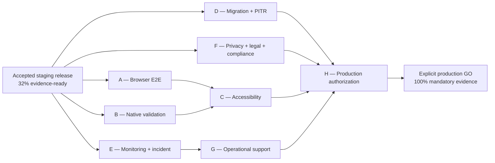

# Resident Workforce OS Launch Readiness Roadmap v1

Date: 2026-08-03

Source package: `docs/runbooks/OPERATIONAL_READINESS_PACKAGE_2026-08-03.md`

Accepted evidence checkpoint: `6ae313a7b948e6ab61f58cea8419a2f7e4688b06`

Current evidence readiness: **32%**

Production status: **NO-GO**

This roadmap organizes the remaining launch evidence. It is documentation only. It does not
authorize deployment, migration execution, infrastructure modification, Stripe activation,
production authentication, real communications, real data or production access.

## 1. Estimation and scoring rules

Effort is expressed as focused person-days after prerequisites and owners are available. It is a
planning range, not a delivery promise. Waiting for professional review, provider access, device
availability, incident participants or change windows is excluded.

Readiness projections use the accepted 17-category evidence model: Green = 1 point, Yellow = 0.5,
Red = 0. A projected percentage assumes every acceptance criterion in that workstream passes. A
completed document or scheduled test earns no readiness credit by itself.

## 2. Critical path

The calendar-critical chain is expected to be whichever is longest among professional/legal review
(F), device/accessibility evidence (A/B/C), and managed recovery validation (D). Workstreams may run
in parallel, but H cannot begin final acceptance until all required predecessors are complete.

## 3. Dependency graph

| Workstream                 | Depends on                                                                       | Enables                      | Cannot be substituted by       |
| -------------------------- | -------------------------------------------------------------------------------- | ---------------------------- | ------------------------------ |
| A Browser E2E              | Immutable staging release, approved synthetic identities, QA window              | C, H                         | Unit/component tests           |
| B Native validation        | Signed staging builds, approved devices, staging endpoints                       | C, H                         | Responsive browser testing     |
| C Accessibility            | A and B stable journeys, Accessibility Reviewer                                  | H                            | Automated scanner alone        |
| D Migration and PITR       | Database owner, independent witness, approved RPO/RTO/retention, isolated target | H                            | Empty local database migration |
| E Monitoring and incident  | Alert destinations, named on-call, immutable release                             | G, H                         | Dashboard configuration alone  |
| F Privacy/legal/compliance | Qualified owners, Terms/Privacy/contracts/tax/retention decisions, D1–D9         | H                            | Engineering interpretation     |
| G Operational support      | E drill results, support owner, support/on-call roster                           | H                            | Runbook without rehearsal      |
| H Production authorization | A–G accepted, exact production plan and costs                                    | Explicit production decision | Staging health or this roadmap |

## 4. Launch dashboard

| Workstream                 | Current             | Target                                                   | Estimated effort             | Production impact                                  | Projected cumulative readiness |
| -------------------------- | ------------------- | -------------------------------------------------------- | ---------------------------- | -------------------------------------------------- | ------------------------------ |
| Baseline                   | Accepted            | —                                                        | —                            | Staging security healthy; production blocked       | 32%                            |
| A Browser E2E              | Blocked             | Browser category Green                                   | 4–7 person-days              | Proves authenticated web journeys and denials      | 38%                            |
| B Native validation        | Blocked             | Mobile category Green                                    | 5–10 person-days             | Proves signed Android/iOS worker journeys          | 44%                            |
| C Accessibility            | Blocked             | Accessibility category Green                             | 4–8 person-days              | Establishes supported assistive use                | 50%                            |
| D Migration + PITR         | Blocked/In Progress | Database and Backup Green                                | 5–9 person-days              | Proves safe schema change and recoverability       | 59%                            |
| E Monitoring + incident    | In Progress/Blocked | Monitoring and Incident Response Green                   | 4–7 person-days              | Proves detection, paging, containment and recovery | 68%                            |
| F Privacy/legal/compliance | Blocked             | Privacy and Legal Green                                  | 10–30 specialist person-days | Establishes lawful policy and D1–D9 authority      | 80%                            |
| G Operational support      | Blocked             | Operations and Customer Support Green                    | 4–8 person-days              | Proves sustainable ownership and escalation        | 92%                            |
| H Production authorization | Blocked             | Authorization and Payments resolved; final plan accepted | 3–5 person-days              | Produces the only valid launch recommendation      | 100% if every gate passes      |

Percentages are conditional forecasts. The recorded percentage remains **32%** until evidence is
executed, reviewed and accepted.

## 5. Workstream A — Browser end-to-end validation

Owner: QA Owner (accountable), Security Reviewer, Release Owner; Accessibility Reviewer observes
journeys that feed Workstream C.

Prerequisites:

- exact immutable staging release and revisions;
- approved synthetic Employer/Admin/Worker identities;
- approved browser/device matrix and test window;
- provider-dependent actions disabled or separately approved in test mode;
- safe screenshot and evidence-storage procedure.

Blockers and evidence:

| Blocker                                      | Evidence required                                                                           | Dependency               | Production impact       | Acceptance criteria                                              |
| -------------------------------------------- | ------------------------------------------------------------------------------------------- | ------------------------ | ----------------------- | ---------------------------------------------------------------- |
| Employer journey unverified                  | Trace from sign-in through request, estimate, submission, timesheet, invoice/document views | Staging identities       | Employer launch blocked | Supported browsers pass; no dead/fake controls or unexpected 404 |
| Admin journey unverified                     | Approval, dispatch, assignment, finance/document and denial results                         | Approved role matrix     | Admin launch blocked    | Correct authorized actions and generic denials                   |
| Worker web journey unverified                | Sign-in, eligible assignment, acceptance, attendance and timesheet results                  | Dedicated Worker API     | Worker launch blocked   | State transitions and retry/error behavior pass                  |
| Cross-organization route coverage incomplete | A→B and B→A denial matrix for every supported entity/document route                         | Synthetic A/B fixtures   | Security launch blocked | No cross-organization record existence or content leaks          |
| Browser/navigation matrix absent             | Control inventory, Back/Next, pagination, modal, keyboard and responsive results            | Stable production builds | Web launch blocked      | Every visible control classified and verified                    |

Estimated effort: **4–7 person-days**. Completion raises the conditional projection to **38%**.

## 6. Workstream B — Native mobile validation

Owner: Mobile QA Owner (accountable), Security Reviewer, Release Owner.

Prerequisites: signed staging-only Android and iOS builds, checksums, approved physical devices,
staging endpoint configuration, synthetic accounts, disabled real location/notification behavior.

| Blocker                        | Evidence required                                                                  | Dependency               | Production impact          | Acceptance criteria                                                       |
| ------------------------------ | ---------------------------------------------------------------------------------- | ------------------------ | -------------------------- | ------------------------------------------------------------------------- |
| No signed Android evidence     | Install, launch, session, assignment, attendance, offline/retry and denial results | Android build/device     | Android launch blocked     | Supported OS/device matrix passes without secret or personal-data leakage |
| No signed iOS evidence         | Equivalent iOS journey evidence                                                    | iOS build/device         | iOS launch blocked         | Supported iOS/iPad matrix passes                                          |
| Permission handling unverified | Location/notification denied, revoked and unavailable cases                        | Synthetic/local adapters | Safety and privacy blocked | Fail-closed behavior; no real tracking or message                         |
| Lifecycle recovery unverified  | Background/foreground, network interruption, session expiry                        | Physical devices         | Reliability blocked        | No duplicated mutation or misleading success                              |

Estimated effort: **5–10 person-days**. Completion raises the conditional projection to **44%**.

## 7. Workstream C — Accessibility certification

Owner: Accessibility Reviewer (accountable), QA Owner, Product Design Owner.

Prerequisites: stable A/B journeys, supported browser/device list, assistive technology and reviewer
availability.

| Blocker                         | Evidence required                                                             | Dependency       | Production impact              | Acceptance criteria                                      |
| ------------------------------- | ----------------------------------------------------------------------------- | ---------------- | ------------------------------ | -------------------------------------------------------- |
| Web assistive use unverified    | Keyboard, focus, screen reader, zoom/reflow, contrast, errors, reduced motion | A                | Web launch blocked             | No critical/serious defect; reviewer signoff             |
| Native assistive use unverified | Platform screen reader, font scaling, external keyboard, orientation          | B                | Mobile launch blocked          | Supported tasks complete with no critical/serious defect |
| Financial PDFs unverified       | Language, reading order, headings, tables and filenames                       | Invoice fixtures | Document accessibility blocked | Bilingual PDF checks and reviewer acceptance             |

Estimated effort: **4–8 person-days**, excluding remediation discovered during review. Completion
raises the conditional projection to **50%**.

## 8. Workstream D — Database migration and PITR validation

Owner: Database Owner (accountable), Infrastructure Owner, Release Owner, independent Database
Witness, Privacy/Retention Owner.

Prerequisites: approved RPO/RTO, reconciled backup retention, immutable migration manifest, managed
backup/PITR point, distinct disposable target, change/cleanup authorization and monitoring window.

| Blocker                                  | Evidence required                                                     | Dependency                      | Production impact           | Acceptance criteria                             |
| ---------------------------------------- | --------------------------------------------------------------------- | ------------------------------- | --------------------------- | ----------------------------------------------- |
| Release migration not rehearsed          | Singleton managed migration, checksums, duration, locks, no-op replay | Isolated production-like target | Schema launch blocked       | Prior/new app compatibility and invariants pass |
| PITR not proven                          | Provider recovery point restored to distinct target                   | Backup policy and witness       | Production blocked          | Approved measured RPO/RTO achieved              |
| Isolation/audit after restore unverified | A/B denial and audit integrity results                                | Restored target                 | Security blocked            | No isolation or audit mismatch                  |
| Cleanup unproven                         | Provider deletion receipt for disposable target                       | Privacy approval                | Operational/privacy blocked | No unauthorized retained restore                |
| Rollback untested                        | Prior immutable image and forward-fix/restore decision drill          | Migration results               | Release blocked             | Timed rollback within accepted objective        |

Estimated effort: **5–9 person-days**, excluding provider wait time. Completion raises the
conditional projection to **59%**.

## 9. Workstream E — Monitoring, alerting and incident response

Owner: Monitoring/Operations Owner (accountable), Primary On-Call, Secondary On-Call, Incident
Commander, Security Reviewer.

Prerequisites: immutable notification destinations, thresholds, dashboards, incident record
location, approved controlled-failure window and privacy-safe logging policy.

| Blocker                   | Evidence required                                                  | Dependency               | Production impact          | Acceptance criteria                                    |
| ------------------------- | ------------------------------------------------------------------ | ------------------------ | -------------------------- | ------------------------------------------------------ |
| Alert delivery unverified | Fired, delivered and acknowledged timestamps                       | Monitoring channels      | Operations blocked         | Primary receives and acknowledges within target        |
| Escalation unverified     | Secondary escalation and commander assignment                      | On-call roster           | Incident readiness blocked | Escalation meets target with immutable evidence        |
| Recovery unverified       | Readiness/5xx scenario, containment, rollback/recovery and closure | Controlled staging drill | Production blocked         | Five-minute stability, canary and expected denial pass |
| Logging review incomplete | Sampled safe fields, exclusions, access and retention              | Privacy/Security policy  | Security/privacy blocked   | Required context present; prohibited data absent       |

Estimated effort: **4–7 person-days**. Completion raises the conditional projection to **68%**.

## 10. Workstream F — Privacy, legal and compliance

Owner: Privacy/Legal Owner (accountable), qualified Québec accountant/lawyer, Contract Kit Owner,
Security Owner, Accounting/Finance Owner and Payment Integration Owner.

Prerequisites: final business model, data inventory, supplier/marketplace contracts, issuer/payment
flows and retained-record requirements.

| Blocker                                  | Evidence required                                                      | Dependency          | Production impact          | Acceptance criteria                                           |
| ---------------------------------------- | ---------------------------------------------------------------------- | ------------------- | -------------------------- | ------------------------------------------------------------- |
| Terms/Privacy not approved               | Signed versions, checksums, effective date and registration gate       | Professional review | Registration blocked       | Approved text bound to release/configuration                  |
| Retention/deletion/legal hold unresolved | Authoritative schedule covering DB, backup, logs and audit             | Privacy + Legal     | Data processing blocked    | D9 and restore cleanup align with schedule                    |
| Québec tax/invoice model unresolved      | Issuer, GST/QST, place-of-supply, registration and correction policy   | Qualified advisor   | Invoice launch blocked     | Effective-dated approved configuration                        |
| Worker/marketplace model unresolved      | Contract language and role responsibilities                            | Legal review        | Marketplace launch blocked | No employment classification inferred by code                 |
| D1–D9 incomplete                         | Signed decision form and corresponding test evidence                   | Specialist owners   | Production blocked         | Every mandatory decision and test accepted                    |
| Payment/provider rules incomplete        | Merchant identity, authorization/capture/refund/dispute and fee policy | D2/D4/D5            | Payments blocked           | Test-mode evidence passes; live mode remains separately gated |

Estimated effort: **10–30 specialist person-days** plus review turnaround. Completion raises the
conditional projection to **80%**.

## 11. Workstream G — Operational support

Owner: Operations Owner (accountable), Customer Support Owner, Release Owner, Privacy Owner and
Primary/Secondary On-Call.

Prerequisites: E drill results, supported features and escalation policies, approved support
channels and privacy-safe tooling.

| Blocker                          | Evidence required                                                       | Dependency               | Production impact        | Acceptance criteria                                    |
| -------------------------------- | ----------------------------------------------------------------------- | ------------------------ | ------------------------ | ------------------------------------------------------ |
| Ownership gaps                   | Named primary/backup roster and acknowledged duties                     | Owner appointments       | Production blocked       | No operational duty lacks accountable coverage         |
| Support process absent           | Intake, severity, response targets, scripts and escalation              | Product/legal boundaries | Customer launch blocked  | Synthetic ticket completes through resolution          |
| Secret/privacy handling untested | Support scripts and tooling review                                      | Privacy policy           | Security/privacy blocked | No password, card, token or personal-data solicitation |
| Launch handoff untested          | Shift handoff, kill switches, maintenance and rollback bridge rehearsal | E                        | Launch blocked           | Timed handoff and escalation pass                      |

Estimated effort: **4–8 person-days**. Completion raises the conditional projection to **92%**.

## 12. Workstream H — Production launch authorization

Owner: Release Owner (accountable), Infrastructure, Billing, Security, Database, Privacy/Legal and
Operations owners.

Prerequisites: A–G accepted; exact release/images; production architecture, plan and official cost;
provider decisions; change window; rollback targets; explicit owner availability.

| Blocker                              | Evidence required                                                     | Dependency | Production impact          | Acceptance criteria                            |
| ------------------------------------ | --------------------------------------------------------------------- | ---------- | -------------------------- | ---------------------------------------------- |
| Authorization coverage incomplete    | Final role matrix and release-bound 401/403 evidence                  | A/F        | Production blocked         | D2 and all privileged routes accepted          |
| Payment launch decision absent       | Test-mode evidence and explicit live-mode exclusion or later approval | F          | Payment capability blocked | Safe scoped launch decision recorded           |
| Production plan absent               | Digest-bound Terraform/resource/IAM/secret/domain plan and cost       | A–G        | Production blocked         | Exact inventory reviewed; no unexpected change |
| Final rollback/go-live review absent | GO/NO-GO packet, bridge roster and stop conditions                    | A–G        | Production blocked         | Every gate Green and owners sign               |
| Explicit production approval absent  | Written SHA/digest-bound approval                                     | All        | Production prohibited      | Separate approval after evidence review        |

Estimated effort: **3–5 person-days** after all prerequisites. Completion reaches **100% only if
every mandatory gate actually passes**. A failed or waived critical gate retains **NO-GO**.

## 13. Recommended execution order

1. Assign all accountable owners and evidence reviewers.
2. Start F immediately because professional review has the greatest uncertain lead time.
3. Run A and B in parallel on the immutable staging release.
4. Begin D once Database/Privacy owners approve recovery inputs and the independent witness is
   available.
5. Run E while A/B/D execute; do not fabricate alert or acknowledgement evidence.
6. Run C after A/B journeys stabilize to avoid certifying moving interfaces.
7. Run G after E establishes the operational escalation path.
8. Reconcile all evidence, defects and D1–D9 outcomes.
9. Begin H only after A–G are accepted; prepare an exact production plan without applying it.
10. Request one separate, digest-bound production GO/NO-GO decision.

## 14. Stop conditions

Stop the affected workstream on cross-organization exposure, secret/personal-data leakage,
unexpected migration or Terraform change, failed restore identity, missing witness, alert delivery
to an unapproved destination, unresolved legal/policy authority, live provider mode, mutable image,
or any request to bypass evidence. Preserve the failure and corrective owner; do not turn a failed
gate Green through a documentation waiver.

## 15. Current recommendation

**NO-GO for production.**

The accepted evidence readiness remains **32%**. This roadmap identifies how the platform can reach
100% mandatory evidence coverage, but it does not itself increase readiness. No production
operation is authorized.
